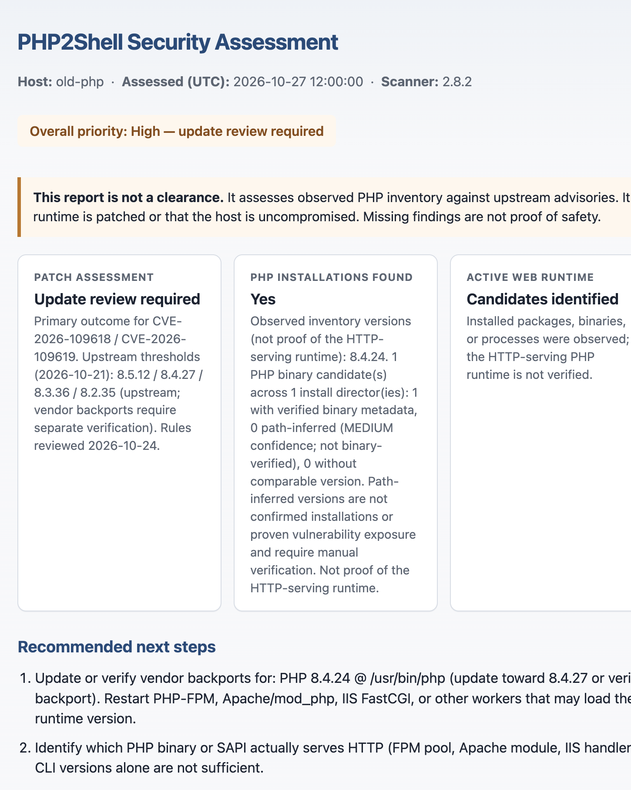

# PHP2Shell

[](https://github.com/Opathedane/php2shell/releases/latest)
[](LICENSE)
[](https://github.com/Opathedane/php2shell/actions/workflows/ci.yml)

**Defensive PHP inventory and patch-review for Windows, Linux, and macOS.**

PHP2Shell is a **read-only**, offline-friendly scanner that discovers PHP installations (and related web-server configuration), compares **observed** versions to the October 2026 upstream security fixes, and writes a local **HTML + CSV** report pair plus a small **status JSON** for automation.

It does **not** exploit systems, execute discovered PHP binaries, upload your data, or certify that a host is patched or uncompromised.

> **Naming:** This project is the **PHP2Shell assessment tool** (a defensive scanner). It assesses advisories such as CVE-2026-109618 / CVE-2026-109619. It is **not** an exploit toolkit and is not affiliated with any similarly nicknamed vulnerability or offensive tooling.

**Latest public release: [v2.8.0](https://github.com/Opathedane/php2shell/releases/tag/v2.8.0).** Version in this tree: 2.8.1 (unreleased) — detection maintenance draft; do not treat as published. Confirm `php2shell version` matches the binary you run, and verify files against `SHA256SUMS` on the [Releases](https://github.com/Opathedane/php2shell/releases/latest) page.

| Advisory | How PHP2Shell treats it |
| --- | --- |
| **CVE-2026-109618**, **CVE-2026-109619** | Compare observed versions to upstream fixes **8.5.12 / 8.4.27 / 8.3.36 / 8.2.35** (21 Oct 2026). Vendor backports need your separate verification. |
| **CVE-2026-115560** | Informational only from observed `php.ini` text — prefer `session.upload_progress.enabled=0`; **no fixed versions invented**. |

---

## Quick start

### 1. Download

| Platform | File |
| --- | --- |
| Windows 10 / 11 / Server 2016+ | `php2shell-windows-amd64.zip` |
| Windows Server **2012 R2** | `php2shell-windows-legacy-amd64.zip` ([notes](docs/WINDOWS-LEGACY-2012R2.md)) |
| Linux amd64 / arm64 | `php2shell-linux-amd64.tar.gz` / `php2shell-linux-arm64.tar.gz` |
| macOS amd64 / arm64 | `php2shell-darwin-amd64.tar.gz` / `php2shell-darwin-arm64.tar.gz` |

Binaries are **not Authenticode-signed**. Always check `SHA256SUMS`. License: [Apache-2.0](LICENSE).

### 2. Run (interactive — do not use `--quiet` the first time)

**Windows (PowerShell)**

```powershell
.\php2shell-windows-amd64.exe doctor
.\php2shell-windows-amd64.exe scan --output-dir $env:ProgramData\PHP2Shell\Reports
```

**Linux**

```bash
chmod +x php2shell-linux-amd64
./php2shell-linux-amd64 doctor
./php2shell-linux-amd64 scan --output-dir "$HOME/.php2shell/reports"
```

**macOS**

```bash
chmod +x php2shell-darwin-arm64   # or php2shell-darwin-amd64
./php2shell-darwin-arm64 doctor
./php2shell-darwin-arm64 scan --output-dir "$HOME/.php2shell/reports"
```

### 3. Open the HTML report

Open the newest `php2shell-*.html` in a browser. Start with **Patch assessment**, then coverage / “what could not be verified.” Full guide: [Understanding reports](docs/UNDERSTANDING-REPORTS.md).



*Representative screenshot only — synthetic lab data (host label `old-php`), not a customer report. Layout remains valid for v2.8.0; CVE thresholds unchanged. Matching HTML: [docs/assets/report-example-patch-assessment.html](docs/assets/report-example-patch-assessment.html).*

**Automation:** add `--quiet` so progress is suppressed; errors and the status line still go to stderr, and `.status.json` remains machine-readable.

---

## What you get

| Output | Purpose |
| --- | --- |
| **HTML** | Human-readable assessment for a single host |
| **CSV** | Same scan for fleet rollup (`php2shell rollup`) |
| **status JSON** | Small machine-readable completion / path metadata for Intune, GPO, scripts |

| Exit code | Meaning |
| --- | --- |
| **0** | HTML+CSV written |
| **1** | Fatal (reports often missing) |
| **2** | HTML+CSV written, coverage incomplete — **still collect** |

Exit **0 is not a security clearance.** Details: [EXIT-CODES-AND-DEPLOYMENT.md](docs/EXIT-CODES-AND-DEPLOYMENT.md).

---

## Coverage at a glance (v2.8.0)

**Does**

- Discover PHP via packages (dpkg/apk), PATH / well-known binaries, IIS/Apache hints, optional `--config-root` / `--deep-root`
- Discover **nginx / PHP-FPM configuration** on well-known Unix paths (local / remote / ambiguous FastCGI classification)
- Assess observed versions against upstream thresholds; optional IR when you supply logs / telemetry / webroot / WAF exports
- Write HTML + CSV + status JSON locally

**Does not**

- Prove complete PHP discovery on every host layout
- Attest the **active HTTP-serving** PHP runtime or its patch state — including when nginx/FPM configs **correlate** (configuration ≠ verified runtime)
- Inventory RPM databases or expand Homebrew / custom prefixes in this release
- Declare the host clean, safe, or uncompromised

Authoritative coverage contract: [docs/SUPPORTED-COVERAGE.md](docs/SUPPORTED-COVERAGE.md). nginx/FPM design: [docs/design/nginx-fpm-discovery.md](docs/design/nginx-fpm-discovery.md).

---

## Documentation

| Topic | Document |
| --- | --- |
| **Docs index** | [docs/README.md](docs/README.md) |
| Installation (consultants) | [docs/INSTALL-FOR-CONSULTANTS.md](docs/INSTALL-FOR-CONSULTANTS.md) |
| Understanding reports | [docs/UNDERSTANDING-REPORTS.md](docs/UNDERSTANDING-REPORTS.md) |
| Platforms & coverage | [docs/SUPPORTED-COVERAGE.md](docs/SUPPORTED-COVERAGE.md) |
| Advanced usage | [docs/ADVANCED-USAGE.md](docs/ADVANCED-USAGE.md) |
| Enterprise (Intune / GPO / collection) | [docs/deployment/](docs/deployment/) |
| Security / disclosure | [SECURITY.md](SECURITY.md) |
| Release notes | [docs/RELEASE-NOTES.md](docs/RELEASE-NOTES.md) · [v2.8.0](docs/releases/v2.8.0.md) |
| Roadmap | [docs/ROADMAP.md](docs/ROADMAP.md) |

---

## Safety defaults

Read-only local scan · no PHP execution · no automatic upload · no browser open · offline by default.

Authorize every scan. Keep reports inside the engagement boundary. Report product defects via Issues (redact customer data); report scanner security issues privately per [SECURITY.md](SECURITY.md).
